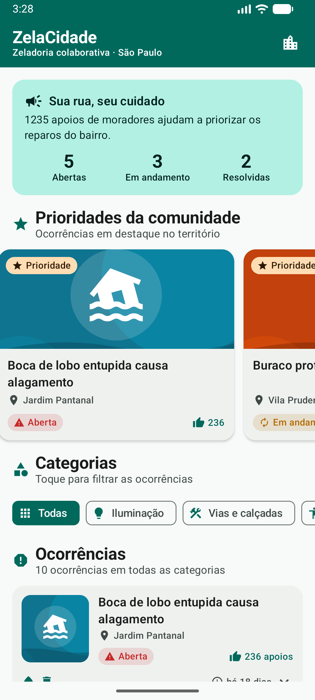
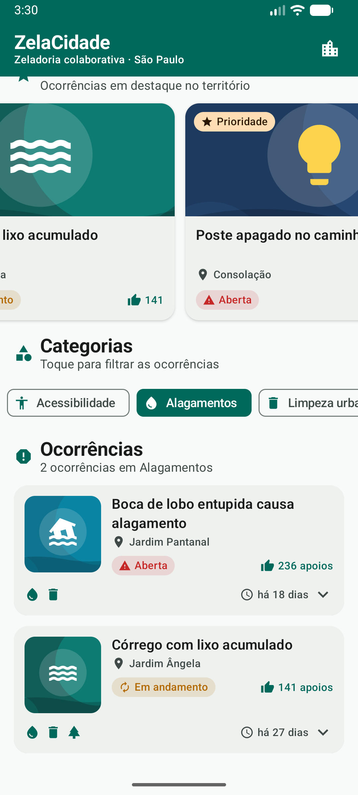
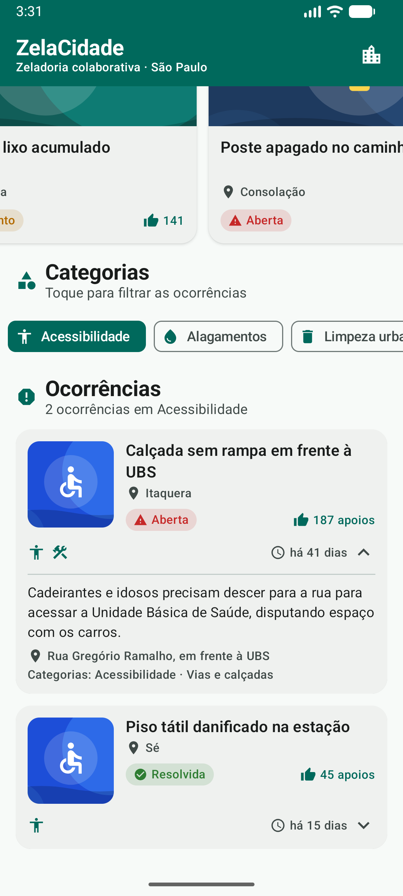

# ZelaCidade — Zeladoria colaborativa

Aplicativo Android desenvolvido em **Kotlin** e **Jetpack Compose (Material Design 3)** para a
**Global Solution 2026.2 — CitizenTech** (3º ano de Sistemas de Informação, FIAP).

## Desenvolvedores

| Diogo Witzel | 552754 |

---

## Tema da Global Solution

**CitizenTech**: tecnologias criadas a partir das necessidades reais das pessoas, para tornar a
vida nas cidades, no campo e nas comunidades mais segura, simples e sustentável.

Entre as sugestões do desafio, o projeto parte de **plataformas de zeladoria colaborativa para
identificar, priorizar e acompanhar problemas dos espaços públicos**.

## Descrição da solução

Buracos, postes apagados, bocas de lobo entupidas, calçadas sem rampa e lixo acumulado afetam
diariamente a segurança, a mobilidade e a saúde dos moradores, principalmente nas periferias.
Os canais oficiais costumam ser burocráticos e o cidadão não sabe se o problema já foi
registrado nem em que pé está o atendimento.

O **ZelaCidade** reúne em um só lugar as ocorrências de zeladoria do território. O morador pode:

- ver as **prioridades da comunidade** (ocorrências em destaque, com mais impacto);
- **filtrar por categoria** (iluminação, vias e calçadas, acessibilidade, alagamentos, limpeza
  urbana, áreas verdes e segurança);
- acompanhar o **status** de cada ocorrência (aberta, em andamento, resolvida), o número de
  **apoios** de outros moradores e há quantos dias o problema está em aberto;
- tocar em uma ocorrência para ver o **relato completo** e o **endereço**.

**ODS relacionados:** ODS 11 (Cidades e comunidades sustentáveis), ODS 10 (Redução das
desigualdades), ODS 9 (Indústria, inovação e infraestrutura) e ODS 13 (Ação contra a mudança
global do clima — prevenção de alagamentos).

## Principais funcionalidades

| Funcionalidade | Como foi implementada |
|---|---|
| Resumo do território | `ResumoCard` mostra ocorrências abertas, em andamento, resolvidas e o total de apoios (dados do repositório). |
| Lista horizontal de destaques | `CarrosselDestaques` (LazyRow) com `DestaqueCard`; os registros vêm de `listarDestaques()`, que filtra pelo atributo `destaque`. |
| Lista horizontal de categorias | `SeletorCategorias` (LazyRow) com `CategoriaChip` (FilterChip); a categoria selecionada fica destacada com a cor primária. |
| Filtro por categoria | Estado `categoriaSelecionada` com `remember { mutableStateOf(Categoria.TODAS) }`; a lista é recalculada com `filtrarPorCategoria()` e recomposta automaticamente. |
| Lista vertical de ocorrências | `LazyColumn` com `items(ocorrencias, key = { it.id })` e `OcorrenciaCard` (imagem, título, bairro, status, apoios, dias e categorias). |
| Detalhes expansíveis | Ao tocar em um `OcorrenciaCard`, o estado local `expandido` mostra o relato e o endereço, com animação. |
| Estado vazio | `EstadoVazio` é exibido caso uma categoria não tenha ocorrências. |
| Tema claro e escuro | `ZelaCidadeTheme` com esquemas de cores Material 3 próprios. |
| Telas maiores | Em tablets/paisagem o conteúdo é limitado a 840 dp e centralizado; a largura dos cards de destaque se adapta à tela. |

## Fluxo de telas

O aplicativo possui uma tela principal (`HomeScreen`), organizada em seções roláveis:

```
┌──────────────────────────────────────┐
│ TopAppBar: ZelaCidade                │
├──────────────────────────────────────┤
│ ResumoCard (abertas / andamento /    │
│             resolvidas / apoios)     │
│                                      │
│ ★ Prioridades da comunidade          │
│ [Destaque] [Destaque] [Desta… ──►    │  ← LazyRow (rolagem horizontal)
│                                      │
│ ▦ Categorias                         │
│ (Todas)(Iluminação)(Vias e ca… ──►   │  ← LazyRow: toque para filtrar
│                                      │
│ ! Ocorrências — "N ocorrências em X" │
│ ┌──────────────────────────────────┐ │
│ │ [img] Título                     │ │  ← LazyColumn (rolagem vertical)
│ │       Bairro · Status · Apoios   │ │     toque → expande detalhes
│ └──────────────────────────────────┘ │
│ ...                                  │
└──────────────────────────────────────┘
```

1. O usuário abre o app e vê o resumo e as prioridades da comunidade.
2. Ao tocar em uma categoria, o chip fica destacado e a lista de ocorrências é atualizada.
3. Ao tocar em **Todas**, a lista volta a exibir todos os registros.
4. Ao tocar em uma ocorrência, o card expande e mostra o relato e o endereço.

## Prints das telas

> Capturas feitas no emulador do Android Studio (salvas em `docs/prints/`).

| Tela inicial | Filtro por categoria | Detalhe expandido |
|---|---|---|
|  |  |  |

## Fonte dos dados

Os dados são **mantidos em memória** pela classe `OcorrenciaRepository` (10 ocorrências
fictícias, inspiradas em problemas comuns de bairros de São Paulo). Não há banco de dados nem
consumo de API.

As imagens das ocorrências são **ilustrações vetoriais locais** (`res/drawable/ilustracao_*.xml`),
criadas a partir de ícones do Material Design (licença Apache 2.0). Assim o app funciona sem
internet, pensando em quem tem conectividade limitada.

## Arquitetura e organização dos packages

```
app/src/main/java/br/com/fiap/zelacidade/
├── MainActivity.kt                 → ponto de entrada; aplica o tema e abre a HomeScreen
├── model/
│   ├── Ocorrencia.kt               → data class do registro (inclui List<Categoria> e destaque: Boolean)
│   ├── Categoria.kt                → enum class das categorias (inclui TODAS para o filtro)
│   └── StatusOcorrencia.kt         → enum class do status de atendimento
├── repository/
│   └── OcorrenciaRepository.kt     → fonte única dos dados; listar, destaques, filtrar, contar
└── ui/
    ├── screens/
    │   └── HomeScreen.kt           → Scaffold + TopAppBar + LazyColumn; guarda o estado do filtro
    ├── components/
    │   ├── OcorrenciaCard.kt       → item da lista principal (vertical)
    │   ├── CategoriaChip.kt        → chip de uma categoria (selecionável)
    │   ├── SeletorCategorias.kt    → LazyRow de categorias
    │   ├── DestaqueCard.kt         → item da lista de destaques
    │   ├── CarrosselDestaques.kt   → LazyRow de destaques
    │   ├── ResumoCard.kt           → resumo do território
    │   ├── TituloSecao.kt          → cabeçalho reutilizável das seções
    │   ├── StatusBadge.kt          → selo de status
    │   ├── InfoItem.kt             → ícone + texto (informações complementares)
    │   ├── EstadoVazio.kt          → mensagem de lista vazia
    │   └── Visuais.kt              → ícones/cores dos enums e textos auxiliares
    └── theme/
        ├── Color.kt, Type.kt, Theme.kt → tema Material 3 do app
```

**Fluxo dos dados:** `OcorrenciaRepository` → `HomeScreen` (estado + chamadas ao repositório)
→ componentes visuais (recebem objetos prontos por parâmetro).

Decisões de arquitetura:

- **Separação de responsabilidades:** os componentes apenas exibem dados e emitem eventos
  (ex.: `onCategoriaSelecionada`). A regra de filtragem fica no modelo (`Ocorrencia.pertenceA`)
  e no repositório (`filtrarPorCategoria`, `listarDestaques`), nunca dentro dos componentes.
- **Sem strings nas regras:** o filtro compara valores da `enum class Categoria`.
- **Estado e recomposição:** `categoriaSelecionada` é um `mutableStateOf`; a lista filtrada é
  recalculada com `remember(categoriaSelecionada)` e o Compose recompõe a tela automaticamente.
- **Modelo independente da UI:** os ícones e as cores dos enums ficam em `ui/components/Visuais.kt`,
  para o pacote `model` não depender do Compose.

## Requisitos do enunciado × implementação

| Requisito | Onde está |
|---|---|
| 1. Lista vertical (LazyColumn, ≥ 5 registros, Card, `items`) | `HomeScreen.kt`, `OcorrenciaCard.kt` — 10 registros |
| 2. Lista horizontal de categorias (LazyRow, ≥ 5 categorias, "Todas", destaque visual, `remember`/`mutableStateOf`, enum) | `SeletorCategorias.kt`, `CategoriaChip.kt`, `Categoria.kt`, `HomeScreen.kt` — 7 categorias + Todas |
| 3. Lista horizontal de destaques (LazyRow, ≥ 3, filtrada pelo atributo) | `CarrosselDestaques.kt`, `DestaqueCard.kt`, `listarDestaques()` — 5 destaques |
| 4. Modelos e enumerações (data class, `List<Categoria>`, booleano de destaque) | `model/` |
| 5. Repositório de dados | `repository/OcorrenciaRepository.kt` |
| 6. Componentização (Scaffold, TopAppBar, Column, Row, Card, LazyColumn, LazyRow, Modifier.padding, Spacer, Text, Icon, Image) | `ui/screens` e `ui/components` — 11 composables reutilizáveis, um por arquivo |
| 7. Organização, boas práticas e estado | packages `model`, `repository`, `ui/screens`, `ui/components`, `ui/theme` |

## Tecnologias

- Kotlin 2.0.21
- Jetpack Compose (BOM 2024.12.01) + Material 3 + Material Icons Extended
- Android Gradle Plugin 8.7.3 / Gradle 8.9
- compileSdk / targetSdk 35, minSdk 26

## Como executar

1. Abra a pasta do projeto no **Android Studio** (Ladybug ou mais recente).
2. Aguarde a sincronização do Gradle.
3. Selecione um emulador ou aparelho (Android 8.0+) e clique em **Run ▶**.
